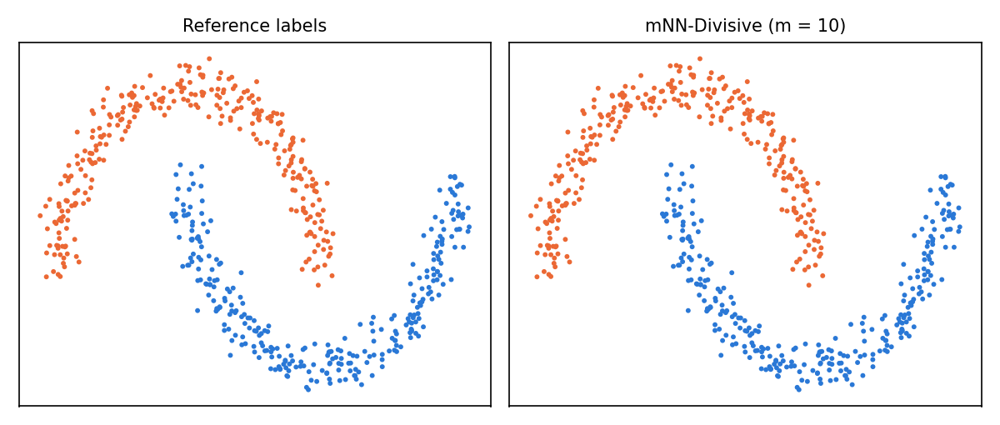

# mNN-Divisive

**Deterministic divisive hierarchical clustering by group-wise nearest-neighbour growing.**

mNN-Divisive builds a cluster hierarchy from the top down. It needs only a dissimilarity
matrix, so it works with any distance (Euclidean, Manhattan, cosine, edit distance, DTW, …),
it has no random components, and it has one main parameter, `m`.

This repository contains the reference implementation and the benchmark code and raw results
of the paper:

> I. Eman, C. Alagöz, F. Aadil, M. Sardaraz. *mNN-Divisive: Deterministic Divisive Hierarchical
> Clustering by Group-Wise Nearest-Neighbour Growing.* Submitted, 2026.



---

## How it works

The algorithm repeatedly splits the largest current cluster in two until there are `K` clusters.
One split of a cluster `C`:

1. **Seeds.** Drop the 5 % of objects with the largest distance to their 5th nearest neighbour
   (likely outliers) and take the two most distant remaining objects as seeds `s0`, `s1`.
2. **Growing order.** Repeatedly pick the unlabelled object with the smallest mean distance to
   the `m` most recently added members of either group.
3. **Assignment.** The picked object joins the group whose `m` nearest members are closer on
   average (group-wise m-nearest-neighbour rule).

`m` controls the behaviour: `m = 1` is a nearest-neighbour rule that can follow curved
clusters; large `m` compares average distances to whole groups and favours compact clusters.
The default `m = 10` was the best setting in our experiments.

Properties: deterministic; invariant to rescaling the distances; one split of `s` objects
costs `O(s²)` time; the full matrix needs `O(n²)` memory.

---

## Installation

```bash
git clone https://github.com/<user>/mnn-divisive.git
cd mnn-divisive
pip install -r requirements.txt
```

The method itself is a single file, `mnn_divisive.py`, and needs only NumPy and scikit-learn.
If [Numba](https://numba.pydata.org/) is installed, a compiled version of the inner loop is used
automatically; otherwise a vectorised NumPy version runs. Both give the same clusters.

---

## Quick start

```python
from mnn_divisive import MNNDivisive

model = MNNDivisive(n_clusters=3, m=10).fit(X)   # X: (n_samples, n_features), Euclidean distance
model.labels_                                    # partition with 3 clusters
model.labels_at(2)                               # coarser level of the same hierarchy

# any dissimilarity: pass a precomputed n x n matrix
MNNDivisive(n_clusters=3, metric="precomputed").fit_predict(D)
```

| Parameter    | Default       | Meaning |
|--------------|---------------|---------|
| `n_clusters` | 2             | number of clusters `K` (the hierarchy is built down to `K` leaves) |
| `m`          | 10            | neighbourhood size of the growing and assignment rules |
| `trim`       | 0.05          | fraction of low-density objects excluded when choosing seeds |
| `knn`        | 5             | neighbour order used to measure density for trimming |
| `metric`     | `"euclidean"` | any `sklearn.metrics.pairwise_distances` metric, or `"precomputed"` |
| `backend`    | `"auto"`      | `"numba"`, `"numpy"` or `"auto"` (Numba if installed) |

Attributes after `fit`: `labels_` (the `K`-cluster partition) and `splits_` (the sequence of
splits, used by `labels_at(k)` for any `1 ≤ k ≤ K`).

---

## Example run

```bash
python example.py
```

Output (NumPy back-end; times depend on the machine):

```
backend: numpy

[moons]  n=600  ARI=1.000  time=25 ms
[wine]   k=1  cluster sizes=[178]  ARI=0.000
[wine]   k=2  cluster sizes=[66, 112]  ARI=0.510
[wine]   k=3  cluster sizes=[66, 58, 54]  ARI=0.787
[wine, Manhattan distance]  ARI=0.880

figure saved to docs/example.png
```

- **moons** – two interleaved half-circles; mNN-Divisive separates them exactly (ARI = 1).
- **wine** – one `fit` gives every level of the hierarchy; `labels_at(k)` reads level `k`.
- **Manhattan distance** – the same method on a user-supplied distance matrix.

---

## Benchmark results

90 datasets (17 UCI datasets, 69 from the
[Gagolewski benchmark suite](https://github.com/gagolews/clustering-data-v1), 4 synthetic),
10 stratified subsamples each, adjusted Rand index (ARI). Twelve hierarchical algorithms,
ordered by average rank (1 = best):

| Algorithm | Avg. rank | Mean ARI | Median ARI | Median time (ms) |
|---|---|---|---|---|
| Genie | 3.32 | 0.726 | 0.784 | 0.9 |
| Ward linkage | 4.87 | 0.536 | 0.567 | 8.4 |
| Divisive Ward | 5.27 | 0.519 | 0.509 | 14.7 |
| Divisive GMM | 5.42 | 0.564 | 0.565 | 67.3 |
| **mNN-Divisive** | 5.47 | 0.508 | 0.549 | 18.2 |
| Bisecting k-means | 6.64 | 0.496 | 0.491 | 67.7 |
| Average linkage | 7.01 | 0.443 | 0.423 | 10.4 |
| Divisive 2-medoids | 7.02 | 0.476 | 0.502 | 44.4 |
| DIANA | 7.37 | 0.472 | 0.497 | 18.6 |
| Complete linkage | 7.84 | 0.430 | 0.397 | 9.4 |
| Single linkage | 8.78 | 0.366 | 0.185 | 6.5 |
| PDDP | 9.01 | 0.390 | 0.392 | 3.1 |

In short: mNN-Divisive is statistically tied with Ward linkage, divisive Ward and divisive GMM;
it is significantly better than average, complete and single linkage and PDDP (Holm-corrected
Wilcoxon tests); and Genie is significantly better than all other methods. It is weaker on
nested and interlocked shapes (e.g. rings, chain links). See the paper for the full analysis.

Raw and summary results are in [`results/`](results):

| File | Content |
|---|---|
| `main_raw.csv` | every dataset × subsample × algorithm (ARI, silhouette, time) |
| `main_summary.csv` | mean and SD per dataset and algorithm |
| `datasets_table.csv` | the 90 datasets (n, dimension, number of clusters, imbalance) |
| `overall_ALL.csv`, `stats_ALL.txt`, `proposed_vs_refs_ALL.csv` | rankings and tests (all 16 algorithms, incl. flat methods) |
| `run_info.txt` | hardware and software of the run |

### Reproducing the benchmark

```bash
pip install -r requirements-benchmark.txt
# download and unzip https://github.com/gagolews/clustering-data-v1
python benchmark.py --source all --gb_root clustering-data-v1 --R 10 --out final_out
```

The first run downloads the UCI datasets into `uci_cache/` (one of the planned UCI datasets,
*seeds*, cannot be downloaded through the UCI interface and is skipped). Before the long run,
the script checks that every algorithm works on a small dataset and stops with a message if one
fails. Useful options: `--source synthetic --R 3` (one-minute check), `--m_sensitivity`
(also run `m = 3, 5, 20`), `--backend numpy|numba`.

---

## Tests

```bash
python -m pytest tests
```

The tests check accuracy on simple data, determinism, scale invariance, nesting of the
hierarchy and (if Numba is installed) that both back-ends agree.

---

## Citation

If you use this code, please cite the paper (details will be updated on publication):

```bibtex
@article{eman2026mnndivisive,
  author  = {Eman, Isha and Alag{\"o}z, Celal and Aadil, Farhan and Sardaraz, Muhammad},
  title   = {{mNN-Divisive}: Deterministic Divisive Hierarchical Clustering by Group-Wise Nearest-Neighbour Growing},
  journal = {Submitted},
  year    = {2026}
}
```

## License

MIT – see [LICENSE](LICENSE).
